<p align="center">
  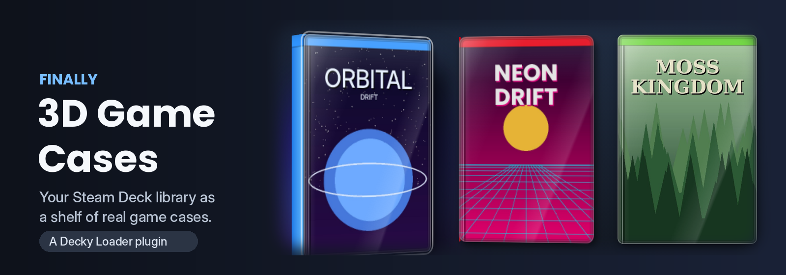
</p>

<p align="center">
  <a href="../../releases/latest"></a>
  
  
  
</p>

<p align="center">
  <b>Turns the covers in your Steam Deck library into real-looking 3D game cases.</b><br>
  Covers you're on turn and lift out of the shelf, with a spine, a clear plastic sleeve, gloss and a shadow.<br>
  Works with <b>non-Steam games</b> too. No build step: download the zip and install.
</p>

<p align="center">
  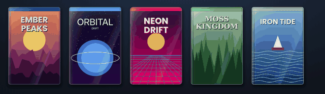
</p>

---

## ✨ Features

|  |  |
|---|---|
| 🎮 **3D cases** | The game you're on turns into a 3D case with a spine, top and back. Everything else stays flat and calm. |
| 🎨 **Console looks** | 21 presets (PS1–PS5, PSP, Xbox, Xbox 360, Sega, PC big box, parody consoles…) plus your own colours. |
| 🗂️ **Per game and per collection** | Give any game or a whole collection its own look. Bulk-assign many games at once. Looks can also be guessed from collection names. |
| 📦 **Case shapes** | Keepcase, cartridge case, jewel case or big box, chosen automatically by the look or set by you. |
| 🧽 **Wear** | Mint, sealed, scuffed, worn, battered, sun-faded or rental. Set by hand, per collection, or let it follow your playtime. |
| 💿 **Launch animation** | Press Play and the case opens, the disc printed with the game's art goes into the slot, with sounds. Before or after Steam's game logo. |
| 🫳 **Feels physical** | Smooth turn in and out, a gentle float, a foil shine, a pick-up when you open a game, and neighbours that lean away like books on a shelf. |
| 🧩 **Non-Steam games** | Shortcuts, emulators and launchers get looks and wear just like Steam games. |
| 🩺 **Self-check and safe mode** | One button checks everything and saves a report. Safe mode turns everything off and stays off after restarts. |
| 🪶 **Light on the battery** | Event-driven, no polling. Covers you're not on are plain CSS; the full 3D box is only drawn for the one you're on. |

<p align="center">
  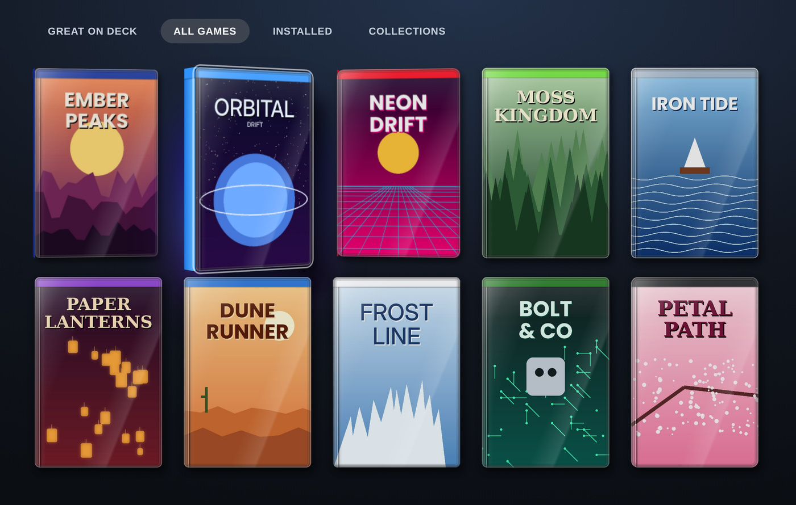
</p>

## 📥 Install

> Requires [Decky Loader](https://decky.xyz) on your Steam Deck.

### Option A: from the release zip (recommended)

1. Go to the [**latest release**](../../releases/latest) and copy the link of `Finally-3D-Game-Cases-vX.Y.Z.zip`.
2. On the Deck, open **Decky settings → General** and turn on **Developer mode**.
3. Open **Decky settings → Developer → Third-Party Plugins → Install Plugin from URL**, paste the link and press **Install**.

You can also download the zip in Desktop Mode and use **Install Plugin from ZIP File** on the same page.

### Option B: by hand (Konsole, Desktop Mode)

```bash
cd ~/Downloads
unzip Finally-3D-Game-Cases-v*.zip
sudo rm -rf ~/homebrew/plugins/3d-game-cases
sudo cp -r 3d-game-cases ~/homebrew/plugins/
sudo systemctl restart plugin_loader
```

### Updating (for example from 1.8.2)

Install the new release zip exactly like the first time: **Install Plugin from URL** with the link of the new zip (or **Install Plugin from ZIP File**, or the Konsole steps above). Decky replaces the old version in place. Your looks, wears, console names and settings are kept, and new options start with sensible defaults.

## 🕹️ Use

Open the **Quick Access menu (•••) → Finally 3D Game Cases**.

- **Looks, colours and presets** opens a page with three tabs: **Games**, **Collections** and **Colours**. Press a row to pick its look and wear.
- A game's own look beats its collection's look, which beats the guess from the collection name, which beats the default.
- **Run self-check** once after installing. It shows a pass or fail line for every step, so one photo is enough if something doesn't work.

<p align="center">
  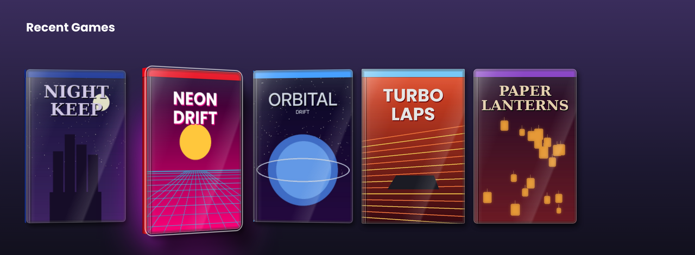
  <br><sub>Optional: also on the Home screen and game pages (“Also on Home and game pages”).</sub>
</p>

## 🎨 Looks

<p align="center">
  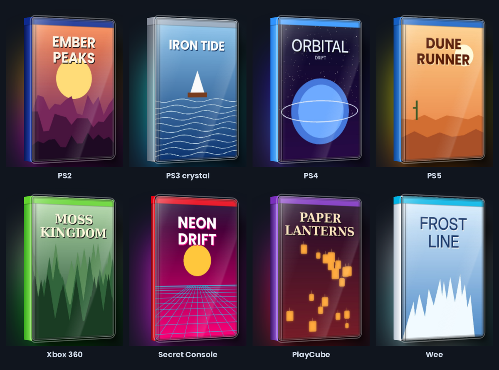
</p>

The parody consoles (**Secret Console**, **PlayCube**, **Wee**, **Wee Too**) can be renamed to anything you like under *Colours → Console names*. Collections whose name contains one of those names get that look automatically.

Make your own looks under *Colours → My colours*: pick a colour, strength, light or dark, a crystal (see-through) finish and a case shape.

### Shapes

<p align="center">
  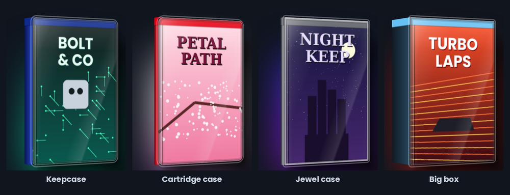
</p>

### Template frames

Prefer a printed console frame to a plain colour? Download frame pictures (for example the console templates in the SteamGridDB collection [Templates](https://www.steamgriddb.com/collection/20087) by MANE0395) and put the files in `~/homebrew/settings/3d-game-cases/templates/`. Then open *Looks, colours and presets → Colours → Templates* and press **Reload templates**. Each picture becomes a look you can pick as the default, for a collection or for one game. The game's cover art is shown inside the frame's dark window. If a window is not found right, put a file with the same name and `.json` next to the picture, e.g. `{"window":[0.04,0.11,0.04,0.04]}` (left, top, right, bottom as fractions of the frame). Respect the licence of whoever made the frames; the plugin does not include any.

### Wear

<p align="center">
  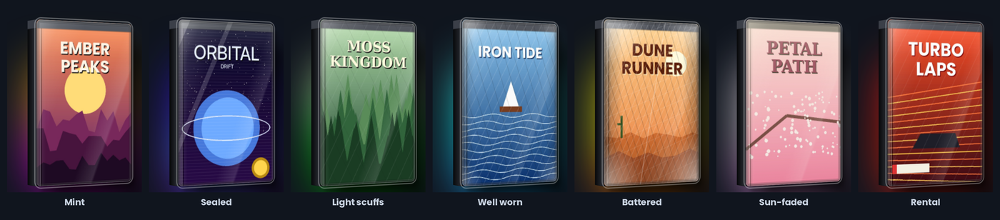
</p>

Turn on **Cases wear as you play** to let playtime decide: never opened is sealed, a little play stays mint, then light scuffs, well worn and battered. A game you haven't touched for a year goes sun-faded. Choose how fast cases wear: slowly, normal or fast.

## 💿 Launch animation

<p align="center">
  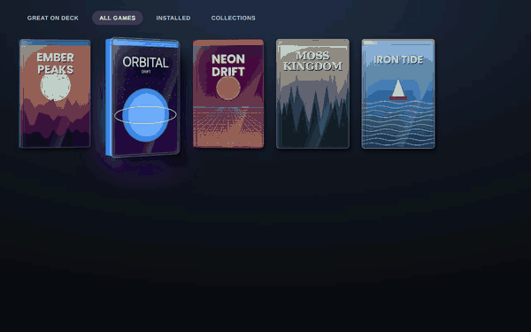
  <br><sub>Press Play: the case flies out of its slot, opens, and the disc goes into the Deck.</sub>
</p>

<p align="center">
  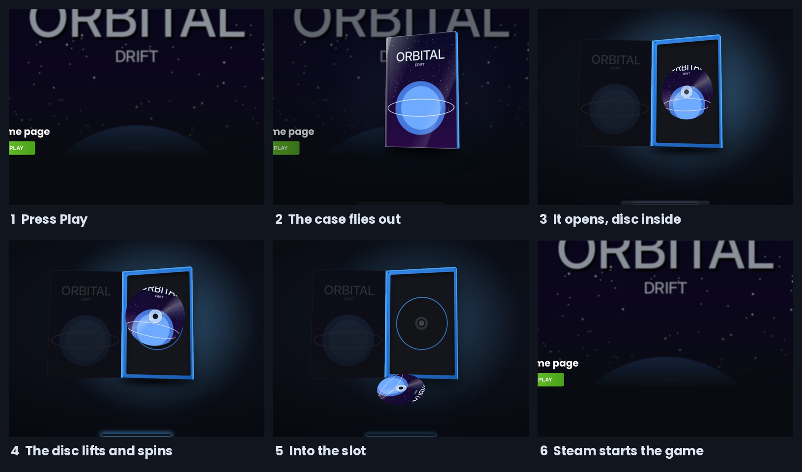
</p>

<table>
  <tr>
    <td align="center" width="50%">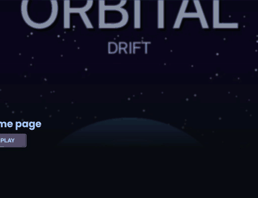<br><sub><b>Disc</b>: printed with the game's cover art, spins up into the slot.</sub></td>
    <td align="center" width="50%">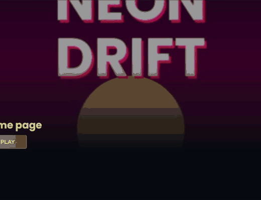<br><sub><b>Game card</b>: cartridge looks (like Secret Console) insert a card instead.</sub></td>
  </tr>
</table>

Turn on **Insert animation on launch** in its own *Insert animation* section. It works on its own, with or without the 3D cases, and plays the moment you press **Play**, in the library or on a game page.

- **Printed with your art:** the case and the disc (or card) use your custom cover first, then Steam's. The art is loaded before the animation starts, and the disc is already sitting in the tray when the case opens.
- **Before or after the logo:** *Before game logo* plays first and covers the screen, then Steam's launch screen with the game logo appears. *After game logo* lets Steam show the logo first, and plays before Steam's small loading animation.
- **Sounds:** the case clicks open, the disc lifts, slides into the slot, the drive spins up and the case snaps shut. They're made live with Web Audio, with no sound files. Turn them off with *Insert sounds*.
- **Slot:** it picks the Deck's bottom slot automatically, or the side slot on a big screen; you can also set it by hand.

## ⚙️ Settings

| Setting | What it does |
|---|---|
| Case shape, thickness, tilt | Shape for all cases (or Auto), how thick, and how far the game you're on turns. |
| Gentle floating · Foil shine | A tiny drift while you stay on a game; a light sweep when it pops out. |
| Plastic sleeve and rounded corners | Clear sleeve edge, hinge ridge and keepcase corners. |
| Pick-up when you open a game | A quick lift when you press A. |
| Neighbours lean away | The games beside the one you're on tilt back a little. |
| Speed | Calm, Normal or Snappy turning in and out. |
| Gloss · Shadow · Colour band | The plastic look of every case. |
| Guess look from collection name | Collections called “PS2”, “Xbox 360”, your console names… get that look. |
| Insert animation on launch | Press Play in the library or on a game page: the case opens and the disc or game card, printed with the game's art, goes into the slot. |
| Before / After game logo | Play the animation before Steam's game-logo launch screen, or after it (before Steam's small loading animation). |
| Eject animation when you quit | Quit a game: the disc comes back out of the slot, drops into its case and the case closes. |
| Sounds | Case clicks, the disc in the slot, the drive spinning up and down, a sealed game's wrap tearing. |
| Shrink-wrap tear | A sealed game's wrap is torn off on its first launch (part of the insert animation). |
| Less motion | *Full motion*, *Less on battery* or *Less motion*: no drifting, shine or leaning neighbours; the covers stay 3D. |
| Fallback · Safe mode | See *Troubleshooting*. |

## 🩺 Troubleshooting

- **Something looks wrong.** Focus a game, open the plugin and press **Run self-check**. Any `[FAIL]` also saves a report to `~/Downloads/3d-game-cases-report-*.txt`; **Save a report now** does the same by hand.
- **A theme changes the cases.** The self-check lists other style sheets (themes and other plugins) and names the ones that also change the cases.
- **The library can't be reached the normal way.** *Fallback: Auto* reaches it through Steam's debug port instead. This uses the plugin's small Python part.
- **Turn it all off.** *Safe mode* removes everything and stays off after restarts. If you can't open the panel at all, run this in Konsole and restart Steam:

  ```bash
  touch ~/homebrew/settings/3d-game-cases/SAFE_MODE
  ```

  Turn it back on from the panel, or delete that file.

## 🔧 How it works

The plugin adds one style sheet to Steam's library window and marks each portrait cover once, when it appears. Covers you're not on are flat CSS paint (no 3D, no extra GPU layers); only the game you're on becomes 3D, and the 3D box (spine, top, back) is only drawn for it. While a game is running the plugin sleeps: no page watching, timers or animations. Steam's own glow and reflection copies are left alone, and Steam's files are never changed. Turning the plugin off or removing it restores Steam's normal look.

## 🛠️ Building from source

You don't need this to use the plugin; the release zip is ready to install.

```bash
npm install
npm run typecheck
npm run build      # dist/index.js and dist/inject.js
npm run package    # release/Finally-3D-Game-Cases-vX.Y.Z.zip
```

Pushing a tag like `1.9.0` (or `v1.9.0`) runs the GitHub Actions workflow, which builds the zip and attaches it to a GitHub release. The tag must match the version in `package.json`.

```
src/index.tsx   Quick Access panel, settings page, startup
src/engine.ts   the case engine (plain DOM and CSS)
src/inject.ts   fallback bundle injected through Steam's debug port
main.py         optional Python part: reports, fallback, safe-mode file
tools/          build script and the Decky globals it uses
```

## 📄 License and credits

BSD-3-Clause © SANSO. See [LICENSE](LICENSE) and [CHANGELOG](CHANGELOG.md).

Not affiliated with Valve or any console maker. Console names are trademarks of their owners and are used only to describe a look. The covers in these screenshots are made up for the demo.
